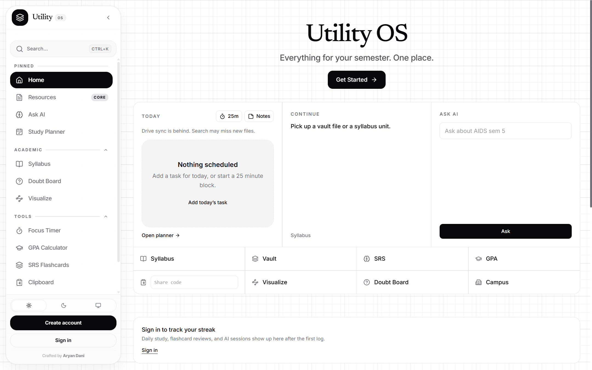
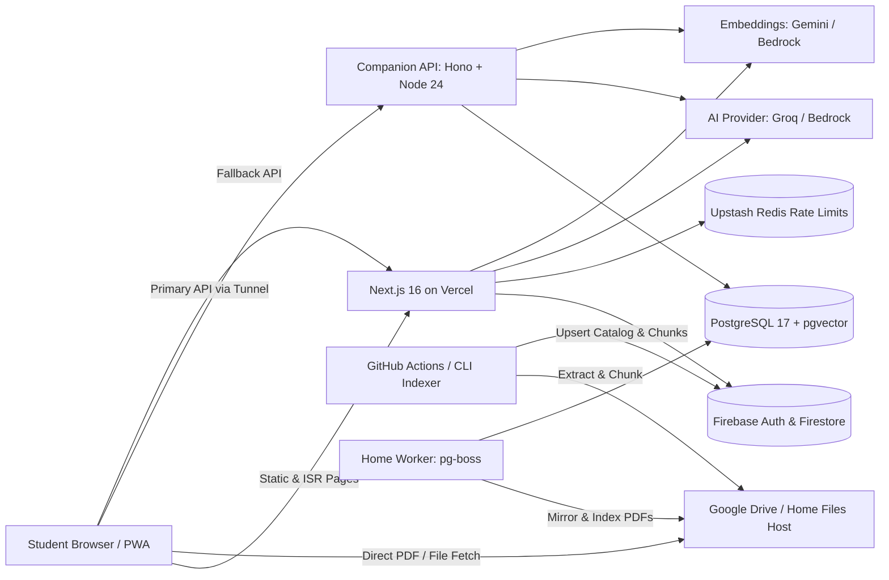

# Utility OS

One academic operating system for MIT-WPU students: semester-scoped notes, a grounded RAG AI tutor, planner, GPA tracker, focus timer, and flashcards in one workspace.

**Live:** [utilityos.tech](https://utilityos.tech) | **Campus Wi-Fi fallback:** [planner-flax-six.vercel.app](https://planner-flax-six.vercel.app) | **Microsoft Store:** [Utility OS](https://apps.microsoft.com/detail/9PPFG0G5R0MG)

## GrowthX Off Campus

**Off Campus Code:** `[PASTE YOUR OFF CAMPUS CODE HERE]`

Utility OS is an all-in-one academic workspace that organizes syllabus units, course resources, AI-grounded Q&A, study planning, and revision tools into a single semester-aware app.
It is built for MIT-WPU engineering students (AIDS, CSE, ECE) who want sourced exam answers from their real course notes instead of digging through scattered Drive folders and WhatsApp forwards.

## Preview

<!-- Replace with a fresh Ask AI or dashboard screenshot if preferred -->


## Features

- **Syllabus and Resource Vault (`/syllabus`, `/resources`)**: Unit-by-unit syllabus alongside notes, PPTs, question banks, PYQs, writeups, and lab codes scoped by academic year, branch, and semester.
- **Ask AI with Hybrid RAG (`/ask`)**: Grounded tutor that retrieves slide-level and page-level chunks using BM25 + vector search fused with Reciprocal Rank Fusion (RRF), returning inline `[S1]`/`[S2]` citations and supporting quick, 5-mark exam, and quiz answer modes.
- **Concurrent Indexing Engine (`runtime/`)**: Extracts text from PDFs, PPTX, DOCX, and XLSX files with concurrent workers, chunks them with overlap, computes corpus BM25 stats, and generates vector embeddings for retrieval.
- **Study Generator (`/ask`, `/api/study`)**: Generates flashcards, multiple-choice quizzes, and PYQ-style questions directly from indexed course notes.
- **Study Planner (`/planner`)**: Weekly and monthly planner with shared plan links and natural-language task parsing.
- **GPA Calculator (`/gpa`)**: SGPA and CGPA tracking with auto-populated MIT-WPU semester subjects.
- **SRS Flashcards and Community Decks (`/srs`, `/community`)**: Leitner-style spaced repetition decks plus shared community decks.
- **Focus Timer (`/timer`)**: Pomodoro study timer with daily activity heatmap tracking.
- **Doubt Board (`/qa`)**: Course-scoped peer Q&A with voting, accepted answers, and resource links.
- **Algorithm Visualizer (`/visualize`)**: Step-by-step pathfinding and search visualizers (BFS, DFS, UCS, and more) with progress tracking.
- **Synced Clipboard (`/clipboard`)**: Account-synced scratchpad with optional 24-hour share links and Drive PDF link support.
- **Campus Hub (`/campus`)**: Faculty directory, seating lookup, and lab lookup powered by the companion campus API.
- **PWA and Microsoft Store (`/install`)**: Installable offline-capable web app packaged for Windows on the Microsoft Store.

## Tech Stack

- **Frontend**: Next.js 16 (App Router), React 19, TypeScript, Tailwind CSS v4, Zustand, Framer Motion, Lucide React
- **Companion Backend (`server/`)**: Node 24, Hono, Drizzle ORM, PostgreSQL 17 with `pgvector`, `pg-boss` worker queues, Cloudflare Tunnel
- **Auth and Cloud State**: Firebase Auth and Firestore (`firebase`, `firebase-admin`), Upstash Redis for distributed AI rate limits
- **Storage and Ingestion**: Google Drive API (shared folder sync + direct browser downloads via `src/lib/driveFileCache.ts`), `pdf-parse`, `officeparser`, `pdfjs-dist`
- **AI and Search**: Vercel AI SDK (`ai` v7), Groq (`@ai-sdk/groq`) for chat/study/summarize, Gemini (`gemini-embedding-001`) for 768-dim vector embeddings, Postgres Full-Text Search + `pgvector`, and Firestore BM25 + vector fallback

## Architecture



## Local Setup

### Prerequisites

- Node.js 24.x (`node -v`)
- npm 10+
- A Firebase project (Auth + Firestore) and at least one AI provider key (`GROQ_API_KEY` or AWS Bedrock credentials)

### 1. Clone and install

```bash
git clone https://github.com/aryan-dani/Utility.git
cd Utility
npm install
```

### 2. Configure environment variables

Copy the example file and fill in your credentials:

```bash
cp .env.example .env.local
```

Minimum variables needed to run the Next.js app locally:

```env
# Firebase client (public)
NEXT_PUBLIC_FIREBASE_API_KEY=
NEXT_PUBLIC_FIREBASE_AUTH_DOMAIN=
NEXT_PUBLIC_FIREBASE_PROJECT_ID=
NEXT_PUBLIC_FIREBASE_STORAGE_BUCKET=
NEXT_PUBLIC_FIREBASE_MESSAGING_SENDER_ID=
NEXT_PUBLIC_FIREBASE_APP_ID=

# Firebase Admin (server routes and sync scripts)
FIREBASE_PROJECT_ID=
FIREBASE_CLIENT_EMAIL=
FIREBASE_PRIVATE_KEY=

# AI assistant
GROQ_API_KEY=

# Optional: vector embeddings (without this, search uses lexical BM25)
GEMINI_API_KEY=

# Optional: Google Drive shared folder sync
GOOGLE_DRIVE_FOLDER_ID=
```

See `.env.example` for the full list of optional variables (Upstash Redis rate limiting, Drive OAuth writes, companion home server URLs, and Ishani campus API).

### 3. Start the dev server

```bash
npm run dev
```

Open [http://localhost:3000](http://localhost:3000).

### 4. Verify locally

```bash
npm run lint
npm run typecheck
npm run test
```

### 5. Optional: Drive sync and RAG indexing

If you have a Google Drive folder configured with the semester tree:

```bash
# Check RAG environment configuration (never prints secrets)
npm run check-rag-env

# Sync catalog metadata from Google Drive
npm run sync-drive

# Extract text, chunk documents, and generate embeddings
npm run index-content

# Evaluate retrieval quality
npm run eval-rag
```

### 6. Optional: Companion server (`server/`)

The companion Hono + Postgres server handles offloaded user state, Q&A, planners, and `pgvector` search:

```bash
cd server
npm install
npm run migrate
npm run dev
```

## How Updates and Hosting Budget Work

Utility OS runs on Vercel Hobby (`10 GB` Fast Origin Transfer, `100 GB` Fast Data Transfer). To stay well within limits:

- API routes return JSON or streamed text only and never proxy PDF or binary file bytes (`src/lib/__guards__/noFileProxy.test.ts` enforces this in CI).
- Browsers fetch PDFs directly from Google Drive or the home files host and cache them locally.
- The Microsoft Store app is a PWABuilder shell pointing to `https://utilityos.tech`, so web deploys update Store users automatically.

## License

Proprietary License - All Rights Reserved. See [LICENSE](LICENSE) for details.

Made by [Aryan Dani](https://www.aryandani.com).
